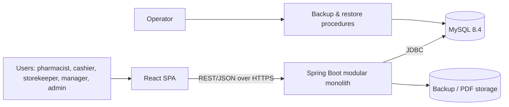
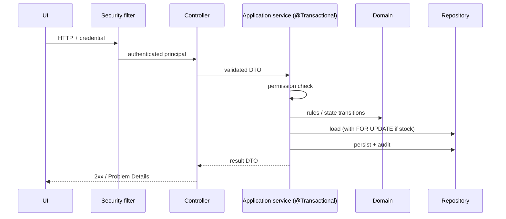
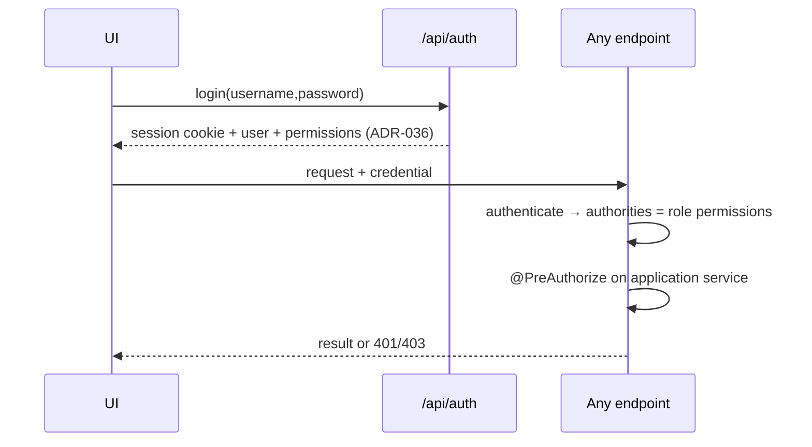

# Architecture — IMS Vétérinaire

> **Status:** Documentation / Architecture Phase — Implementation Not Started
> **Scope:** system structure, flows and cross-cutting concerns. Conceptual only; no Docker or deployment scripts.
> **Last updated:** 2026-10-18

Tags: `SRC` Spec · `SCH` Source Schema · `REC` recommendation · `OD-nnn` · `ADR-nnn`.

## 1. System context



One deployable backend, one database, one SPA served as static files (by the reverse proxy or the backend `[REC]`). No external integrations are required by the Spec; none are assumed.

## 2. Logical architecture

### 2.1 Frontend
React + Vite SPA (see `frontend.md`). Talks only to `/api`. Holds no business truth; renders server results.

### 2.2 Backend
Modular monolith (ADR-006): modules `auth`, `users`, `catalog`, `inventory`, `purchasing`, `sales`, `finance`, `reporting`, `audit`, `numbering`, `settings`, `printing`, `backup`, `common`. Layers per module: api → application → domain → infrastructure (see `backend.md`).

### 2.3 Database
MySQL, InnoDB, utf8mb4, 44 tables + rewritten views (see `database.md`, `database-migration.md`). The database enforces structural integrity (FK, UNIQUE, CHECK, NOT NULL, limited triggers); business orchestration lives in Spring.

### 2.4 REST architecture
Resource-oriented JSON API under `/api`; state changes that are not simple CRUD are modelled as `POST …/{action}` (confirm, cancel, recall). Errors are Problem Details with business codes (ADR-020). Contract in `api.md`.

## 3. Module dependency rules

Allowed direction (A → B means A may call B's public port):

```
common  <- everything
auth -> common, users, settings      (settings: login throttling limits, ADR-038)
users -> common, audit               (identity changes are audited, BR-AUDIT-001)
catalog -> common, settings, audit  (price changes are audited, BR-PROD-006)
numbering -> common
settings -> common, audit            (setting changes are audited, BR-AUDIT-001)
audit -> common
inventory -> catalog, numbering?, settings, audit, users (user-name read port only, ADR-089)
purchasing -> catalog, inventory, numbering, settings, audit, users (user-name read port only, ADR-089)
sales -> catalog, inventory, numbering, settings, audit, [CreditLimitPort]
finance -> sales(read ports), purchasing(read ports), numbering, audit, settings   (implements CreditLimitPort)
reporting -> read-only views over all
printing -> read ports of purchasing/sales/finance
backup -> settings, audit
```

Rules:
1. No cycles. `sales → finance` is expressed only through `CreditLimitPort` (defined in sales, implemented in finance) and finance → sales through read ports.
2. A module accesses another module's data **only** through its public application ports or a `reporting` view — never its repositories or tables. **Documented exception (ADR-090):** `inventory`'s `ProductStockConditions`, implementing the catalog port `ProductStock`, returns constant JPQL conditions over its own `Lot` and the product alias (`p.minStock`, `p.reorderPoint`) that the catalog appends to its searches, with bind parameters only; `ModuleSqlBoundaryTest` allows catalog names in no other inventory class and inventory names in no catalog class.
3. Only `inventory` writes `stock_movements` and `lots.quantity_on_hand` (BR-STOCK-003), through `StockService` (ADR-088); `purchasing`, `sales`, `returns` call `StockService`. Stock entering lots by identity (goods receipts, opening stock) goes through inventory's `StockEntries` (find or create under lock, weighted-average cost ADR-098, supplier of a new lot, blocking of a non-conforming lot), which posts through `StockService`; other modules name lots through `LotReferences`. The reorder generation reads what is on open orders through inventory's `OpenOrders` interface, implemented by `purchasing` (as ADR-090, so inventory never depends on purchasing); `purchasing` converts proposals through inventory's `ProposalConversions`.
4. Only `finance` writes payments, allocations and cash movements.
5. Only `numbering` allocates document numbers. Only `common`'s `IdempotencyKeys` writes `idempotency_keys` (ADR-104; used by the modules that create numbered documents).
6. Dependencies are enforced by an architecture test (ArchUnit-style) from Phase 0 (`testing.md` §10).

## 4. Request flow



## 5. Transaction boundaries

| Use case | Boundary | Locks |
|---|---|---|
| Confirm goods receipt | one tx: lots upsert, movements, PO status/received qty, audit | lot rows (if existing lot merges) |
| Confirm sale / POS | one tx: lock lots (asc id) → validate → credit check → number → movements → payments → status → audit | lots, customer (if credit) |
| Customer return | one tx: validate vs sold − returned, credit note, restock movement, payment/refund per OD-005 | original lines, lots |
| Supplier return | one tx: lock lots, validate, movement, record | lots |
| Adjustment | one tx: lock lot, movement, audit | lot |
| Count regularisation | one tx: lock all affected lots (asc id), movements, close | lots |
| Recall / block | one tx: status change, audit; buyers report read-only | lot |
| Payment | one tx: payment, allocations, balance guard, audit | invoice rows, customer |
| Cash session close | one tx | session |
| Number allocation | inside the caller's tx | sequence row |

Principles: short transactions; lock order ascending by lot id (ADR-012/013) to avoid deadlocks; no I/O outside DB in a transaction; PDFs after commit; failure = full rollback (BR-STOCK-003). Isolation READ COMMITTED (ADR-012). Idempotency keys stored in the same tx as the result for document-creating POSTs.

## 6. Authentication and authorisation flow



Authority = permission codes (ADR-029); roles are bundles. The backend recomputes permissions per request/session; the SPA's copy is cosmetic.

## 7. Error handling

Single advice → Problem Details; domain code catalogue in `api.md` §3; constraint-name mapping; no internal details leaked; traceId in header and body; UI maps `code` → message. Retry only for deadlock/lock-timeout inside the service.

## 8. Validation architecture

Defence in depth: UI (UX) → Bean Validation (shape) → application/domain (business) → DB constraints (integrity). A rule is "enforced" only where `business-rules.md` says; the DB layer is never relied on for UX but always present for stock non-negativity and uniqueness.

## 9. Observability

Structured JSON logs (traceId propagated, `X-Trace-Id`), Actuator `health` (and `info`) only, exposed to the operator network (ADR-031); metrics/tracing stack deferred (non-goal for v1). Audit log is the business trace; application log is the technical trace.

## 10. Configuration management

Profiles `dev|test|prod`; non-secret defaults in repo; secrets via environment or secret store; business parameters in `app_settings` (alert thresholds, VAT, rounding, locale); Flyway versioned migrations under `backend/src/main/resources/db/migration` (to be created in Phase 0/1); `ddl-auto=validate`.

## 11. Database change management

Flyway, forward-only, small scripts (MySQL DDL is non-transactional, ADR-018). Each migration is tested on empty DB and on data from the previous release. Destructive changes via expand/contract. No manual changes to environments.

## 12. Deployment (conceptual only)

- Single Linux host (VM or bare metal) running: reverse proxy (TLS) → Spring Boot JAR; MySQL on the same or a separate host; static SPA served by the proxy; scheduled backup job and off-host copy (OD-021).
- Environments: dev (developer machine), test/CI (Testcontainers), production. Staging recommended `[REC]`.
- Time: servers on UTC; business time zone `Africa/Algiers` in settings (ADR-033).
- Containers/orchestration are **not** specified in this phase (no Docker artefacts to be written).

## 13. Security architecture summary

Backend = trust boundary; TLS everywhere; hashed passwords; permission-based RBAC; rate limiting on login; secrets outside the repo; audit of sensitive actions; parameterised queries only; CORS allow-list; security headers; backups protected (details `security.md`).

## 14. Quality attributes

| Attribute | Target | Mechanism |
|---|---|---|
| Correctness of stock | zero negative / drifting balances | ledger + CHECK + locks + integrity check |
| Performance | search < 1 s, confirm sale < 2 s `[REC]` at ~50 k products | indexes, contains-search on 50,000-product reference dataset (ADR-048), short tx |
| Availability | business hours; restore RTO/RPO per OD-021 | backups |
| Maintainability | module boundaries tested | architecture tests, ADRs |
| Auditability | all sensitive actions traced | audit module |
| Portability | MySQL specifics isolated in migrations/repositories | `database-migration.md` |

## 15. Architectural risks

1. Hidden PostgreSQL assumptions in the source schema (see `database-migration.md`).
2. Sales/payment semantics unresolved (OD-002, OD-003) — blocks the POS design if left open.
3. Lock contention at the counter on popular lots — mitigated by short transactions and ordering.
4. Collation making codes case-insensitive (ADR-024; usernames ADR-041, SKUs ADR-051; lot numbers ADR-058, barcodes `utf8mb4_bin`).
5. Numbering gaps vs legal requirement: no gap from a failed transaction (ADR-097); the legal rule for sales invoices is confirmed before Phase 7.

## 16. Decisions index

ADR-001…069 and OD-001…032 are in `decisions.md`; those most structural here: ADR-006 (modular monolith), ADR-012/013 (isolation/locking), ADR-017 (triggers), ADR-018 (Flyway), ADR-020 (errors), ADR-028 (stock representation), ADR-029 (RBAC).
