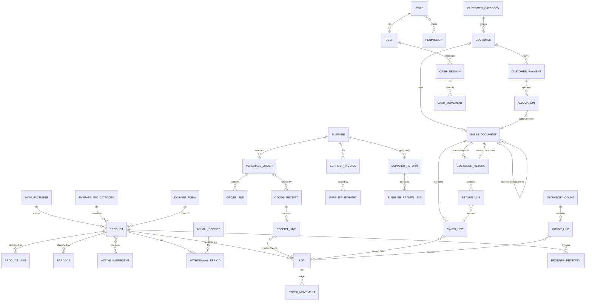
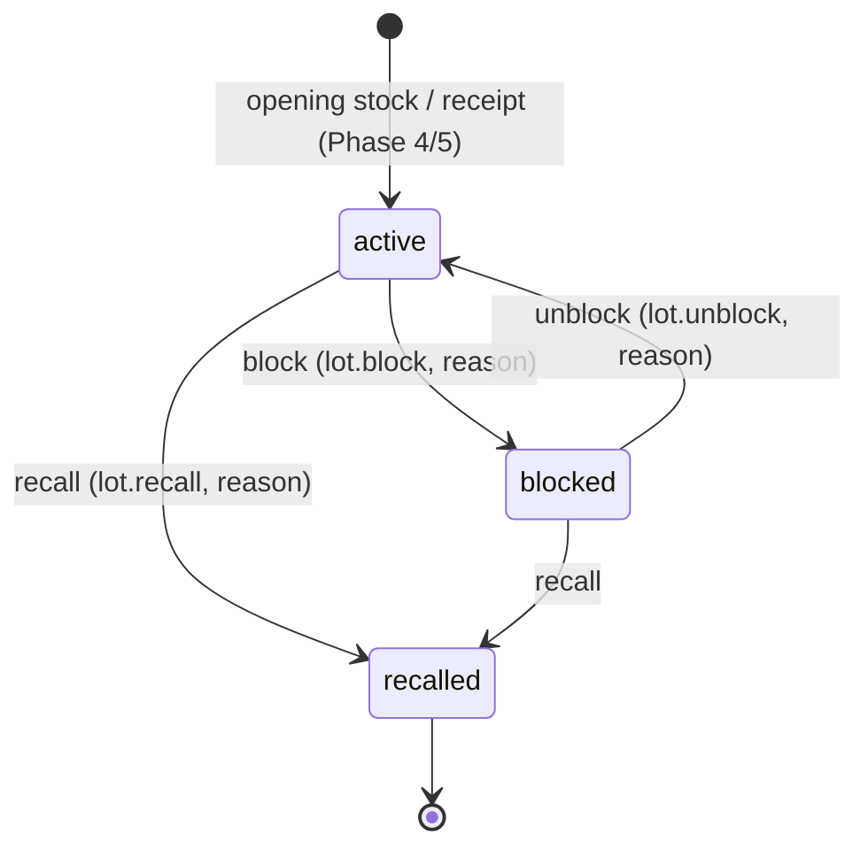

# Domain Model — IMS Vétérinaire

> **Status:** Documentation / Architecture Phase — Implementation Not Started
> **Last updated:** 2026-10-18

Conceptual model of the business domain. It says *what the things are, how they relate, who owns them, how they change state and which invariants always hold*. It does not contain Java code. Table definitions are in `database.md`, rules in `business-rules.md`.

## 1. Four vocabularies — keep them apart

| Concept layer | What it is | Naming rule | Example (Product) |
|---|---|---|---|
| **Domain entity** | Business object with identity and behaviour, lives in the service/domain layer | Singular PascalCase | `Product` |
| **Database table** | Persistent structure (see `database.md`) | plural snake_case, names from the Source Schema | `products` |
| **DTO** | Shape exchanged with a client; never a JPA entity (ADR-019) | `<Entity><Purpose>Request/Response/Summary` | `ProductSummary`, `ProductDetail`, `ProductCreateRequest`, `ProductUpdateRequest` |
| **API resource** | Addressable thing in the REST API (see `api.md`) | plural kebab-case path | `/api/products/{id}` |

A JPA entity is a persistence mapping of a domain entity; it is an implementation detail of one module and is never serialised to the API.

## 2. Modules and aggregates (overview)

| Module (package) | Aggregates (root → children) | Owns tables |
|---|---|---|
| `user`, `auth` | **User**; **Role** → Permission links | users, roles, permissions, role_permissions |
| `settings` | **Setting** | app_settings |
| `audit` | **AuditEntry** (append-only) | audit_log |
| `numbering` | **DocumentSequence** | document_sequences |
| `product` | **Product** → Barcode, ActiveIngredientLink, WithdrawalPeriod, ProductUnit; reference lists (**Manufacturer, TherapeuticCategory, DosageForm, ActiveIngredient, AnimalSpecies**) | products, product_*, manufacturers, therapeutic_categories, dosage_forms, active_ingredients, animal_species |
| `inventory` | **Lot** + its **StockMovement** ledger (one consistency boundary); **InventoryCount** → CountLine; **ReorderProposal** | lots, stock_movements, inventories, inventory_lines, reorder_proposals |
| `supplier` | **Supplier** → PriceHistoryEntry | suppliers, supplier_price_history |
| `purchasing` | **PurchaseOrder** → OrderLine; **GoodsReceipt** → ReceiptLine | purchase_orders(+lines), goods_receipts(+lines) |
| `customer` | **Customer**; **CustomerCategory**; CustomerPrice | customers, customer_categories, customer_product_prices |
| `sales` | **SalesDocument** → SalesLine | sales_documents(+lines) |
| `returns` | **CustomerReturn** → ReturnLine; **SupplierReturn** → ReturnLine | customer_returns(+lines), supplier_returns(+lines) |
| `payment` | **CustomerPayment** → Allocation; **SupplierPayment** | customer_payments, payment_allocations, supplier_payments |
| `finance` | **CashSession** → CashMovement; **SupplierInvoice** | cash_sessions, cash_movements, supplier_invoices |
| `backup` | **BackupRecord** | backup_log |
| `reporting`, `printing` | no own aggregates (read models, renderers) | views / queries |

## 3. Entity relationship overview

## 4. Entity catalogue

For each entity: **purpose · key attributes · relationships (cardinality) · lifecycle · invariants**. Attribute names are conceptual; column names in `database.md`.

### 4.1 Identity and administration

| Entity | Purpose / key attributes | Relationships | Lifecycle | Invariants |
|---|---|---|---|---|
| **User** | A person who operates the system: username, full name, email, role, active flag, last login | *→1 Role | created → active ⇄ inactive (never deleted) | username unique; inactive cannot authenticate (BR-SEC-004); password only as hash (BR-SEC-003) |
| **Role** | Named permission set: Administrator, Pharmacist, Seller, Accountant | 1—* User; *—* Permission | seeded; edited by Administrator | name unique |
| **Permission** | Atomic right, e.g. `sale.cancel`, `price.edit` | *—* Role | seeded by migration; extended by releases | code unique |
| **Setting** | Key/value configuration (`expiry_alert_days`, `default_vat_rate`) | — | editable by Administrator, audited | value format validated (BR-LOT-010) |
| **AuditEntry** | Who did what to which entity, old/new values, IP, time | *→0..1 User | append-only | immutable (BR-AUDIT-002) |
| **DocumentSequence** | Counter per (document key, year) | — | row-locked on use | never decreases within committed state (BR-DOC-001) |

### 4.2 Product catalogue

| Entity | Purpose / key attributes | Relationships | Lifecycle | Invariants |
|---|---|---|---|---|
| **Product** | A medicine: SKU, commercial name, base unit, VAT, purchase price, sale price, min/max/reorder thresholds, archived flag | *→0..1 DosageForm, TherapeuticCategory, Manufacturer; 1—* ProductUnit, Barcode, WithdrawalPeriod; *—* ActiveIngredient; 1—* Lot | active ⇄ archived | SKU unique; base unit set; `min ≤ max`; prices ≥ 0 (BR-PROD-001…005) |
| **ProductUnit** | Packaging/sub-unit: name, factor to base unit, optional price (else derived, ADR-063), sellable flag | *→1 Product; 0..* Barcode | created; factor locked once used | factor > 0, whole for non-divisible products; name unique per product (BR-UNIT-001, -004) |
| **Barcode** | Code + type (EAN13, CODE128, QR) | *→1 Product, *→0..1 ProductUnit of that product (none = base unit, ADR-057) | added / removed | code unique across catalogue, exact match (BR-PROD-002, ADR-058); format by type (BR-PROD-008) |
| **ActiveIngredient (DCI)** | Active substance; strength per product via link | *—* Product | reference data | name unique |
| **WithdrawalPeriod** | Meat/milk/egg waiting days per (product, species) | *→1 Product, *→1 AnimalSpecies | maintained with product | one per pair; days ≥ 0 (BR-PROD-007) |
| **Manufacturer, TherapeuticCategory, DosageForm, AnimalSpecies** | Reference lists | 1—* Product (species via periods) | reference data | name unique |

### 4.3 Lots and stock

| Entity | Purpose / key attributes | Relationships | Lifecycle | Invariants |
|---|---|---|---|---|
| **Lot** | A received batch of one product: lot number, expiry date, unit cost, quantity on hand (base unit), status, block info | *→1 Product, *→0..1 Supplier (from Phase 5); 1—* StockMovement | stored **active ↔ blocked → recalled**; expired and depleted computed (§5.1) | identity (product, lot number, expiry) unique; `quantity_on_hand ≥ 0`; equals Σ movements (BR-STOCK-001, -007) |
| **StockMovement** | One signed change of one lot: type, quantity (base), reference, reason, operator, time | *→1 Lot, *→1 Product, *→1 User | append-only | immutable; sign by type; reason for adjustments (BR-STOCK-003, -005, -006) |
| **InventoryCount** | A counting session: type (full/cycle), status, notes | 1—* CountLine; *→1 User (started by) | **open → closed \| cancelled** | one open full count; closed immutable (BR-INV-004, -007) |
| **CountLine** | Lot, theoretical quantity, counted quantity, variance, regularised flag | *→1 InventoryCount, *→1 Lot | counted → regularised | variance = counted − theoretical; regularised once |
| **ReorderProposal** | Suggested purchase: product, supplier, current & suggested quantity, status | *→1 Product, *→0..1 Supplier | **pending → converted \| dismissed** | one pending per product (BR-STOCK-010) |

### 4.4 Purchasing

| Entity | Purpose / key attributes | Relationships | Lifecycle | Invariants |
|---|---|---|---|---|
| **Supplier** | Laboratory or wholesaler: name, kind, tax id, contacts, payment terms, active | 1—* PurchaseOrder, GoodsReceipt, SupplierInvoice, PriceHistoryEntry, SupplierReturn | active ⇄ inactive | terms ≥ 0; inactive not usable (BR-PURCH-011) |
| **PriceHistoryEntry** | Price and discount for a supplier×product from a date | *→1 Supplier, *→1 Product | append-only | price ≥ 0; discount 0–100 |
| **PurchaseOrder** | Order to a supplier: number, status, dates, totals HT/VAT/TTC | *→1 Supplier; 1—* OrderLine; 0..* GoodsReceipt | **draft → validated → sent → partially_received → closed; → cancelled** (§5.2) | server-computed totals; only drafts editable (BR-PURCH-001…003) |
| **OrderLine** | Product, unit, quantity, base quantity, received base quantity, price, discount, VAT | *→1 PurchaseOrder, *→1 Product, *→0..1 ProductUnit | with order | quantity > 0; received ≤ ordered unless OD-015 |
| **GoodsReceipt** | Physical receipt: number, supplier doc ref, who/when, notes | *→0..1 PurchaseOrder, *→1 Supplier; 1—* ReceiptLine | created and confirmed in one step (no draft in Source) | atomic with stock posting (BR-PURCH-007) |
| **ReceiptLine** | Lot, base quantity, unit cost, conformity flag, PO line | *→1 GoodsReceipt, *→1 Lot, *→0..1 OrderLine | with receipt | lot number + expiry mandatory (BR-PURCH-005) |
| **SupplierReturn** (+ lines) | Goods sent back: reason; lines (lot, base quantity) | *→1 Supplier | created and confirmed | reason mandatory; ≤ lot stock (BR-PURCH-009) |

### 4.5 Customers and sales

| Entity | Purpose / key attributes | Relationships | Lifecycle | Invariants |
|---|---|---|---|---|
| **Customer** | Breeder / veterinarian / other: name, farming type, wilaya, commune, address, phone, category, follow-up vet, credit limit, active | *→0..1 CustomerCategory; *→0..1 Customer (vet); 1—* SalesDocument, Payment, CustomerPrice | active ⇄ inactive | vet link references a veterinarian; limit ≥ 0 (BR-CUST-001, -002) |
| **CustomerCategory** | Group with a default discount % | 1—* Customer | reference data | discount 0–100 |
| **CustomerPrice** | Preferential price per customer×product (per base unit) | *→1 Customer, *→1 Product | maintained, audited | price ≥ 0 |
| **SalesDocument** | Quote / delivery note / invoice / receipt / credit note: number, status, customer (optional), parent, credit flag, due date, cash session, totals | 1—* SalesLine; *→0..1 Customer; *→0..1 parent; *→0..1 CashSession | **draft → confirmed → cancelled** (§5.3) | unique (type, number); credit ⇒ customer; confirmed immutable (BR-SALE-004, -012) |
| **SalesLine** | Product, lot, unit, target species, quantities, price, cost snapshot, discount, VAT, amounts | *→1 SalesDocument, *→1 Product, *→0..1 Lot | with document | lot required at confirmation; quantity_base ≤ lot balance (BR-SALE-005, -015) |
| **CustomerReturn** (+ ReturnLine) | Return of sold goods: reason, original document, credit note; lines with sale line, base quantity, disposition | *→1 SalesDocument; 0..1 credit note | created and confirmed | cumulative returned ≤ sold (BR-RET-001) |

### 4.6 Finance

| Entity | Purpose / key attributes | Relationships | Lifecycle | Invariants |
|---|---|---|---|---|
| **CustomerPayment** | Money received from a customer: method, amount, reference, time | *→1 Customer, *→0..1 CashSession; 1—* Allocation | immutable once recorded; reversed by counter-entry | amount > 0; allocations ≤ amount (BR-PAY-001, -002, -003) |
| **Allocation** | Part of a payment applied to an invoice | *→1 Payment, *→1 SalesDocument | immutable | ≤ invoice outstanding |
| **SupplierInvoice** | Supplier's bill or credit note: number, dates, total | *→1 Supplier, *→0..1 GoodsReceipt; 1—* SupplierPayment | open → partly/fully paid (derived) | unique per supplier+number (BR-PAY-008) |
| **SupplierPayment** | Payment to a supplier, possibly an advance | *→1 Supplier, *→0..1 SupplierInvoice | immutable | ≤ remaining (BR-PAY-009) |
| **CashSession** | Cashier's till session: opening, expected, counted, variance | *→1 User; 1—* CashMovement | **open → closed** (§5.5) | one open per cashier; closed immutable (BR-CASH-001, -004) |
| **CashMovement** | Cash in/out by method, optionally linked to a payment | *→1 CashSession | immutable | amount > 0 |

## 5. State machines

### 5.1 Lot
Stored status (ADR-059, ADR-060):

`recalled` is terminal. **Expired** (`expiry_date` < business date, ADR-055) and **depleted** (quantity 0) are computed, never stored. Effective status = first that applies of recalled, blocked, expired, depleted, active; a depleted lot receiving stock is active again without any transition. Sellable ⇔ stored `active` ∧ not expired ∧ quantity > 0 (BR-STOCK-011). Implemented by a pure domain object (`LotStatus` transition table) and an `ExpiryPolicy` (business date + thresholds) so both are unit-tested without a database.

### 5.2 Purchase order
`draft → validated → sent → partially_received → closed`; `draft | validated | sent → cancelled`. Receipts advance it automatically; the first receipt moves a `sent` order to `partially_received`; full reception closes it (BR-PURCH-001, -004).

### 5.3 Sales document
`draft → confirmed`; `confirmed → cancelled` only if OD-004 allows. `draft → cancelled` (abandon). A confirmed stock-moving document has posted movements; quotes never do (BR-SALE-002, -003, -014).
Derivation chain: `quote → delivery_note → invoice`, `invoice | receipt → credit_note` (BR-SALE-001).

### 5.4 Inventory count
`open → closed` (after regularisation of lines) or `open → cancelled`.

### 5.5 Cash session
`open → closed`; closing fixes expected, counted and variance.

### 5.6 Reorder proposal
`pending → converted` (to a PO line) or `pending → dismissed`.

## 6. Value objects and domain services

| Concept | Kind | Description |
|---|---|---|
| **Quantity (base)** | Value object | `BigDecimal` in base units; conversion via ProductUnit factor; whole numbers for non-divisible products (ADR-050) |
| **Money** | Value object | `BigDecimal` + scale/rounding policy (OD-007); currency DZD (ADR-033) |
| **Percentage** | Value object | 0–100 |
| **LotIdentity** | Value object | (product, lot number); the expiry date must match the existing lot (ADR-070) |
| **DocumentNumber** | Value object | `KEY-YYYY-NNNNNN` (format OD-017) |
| **ExpiryAlertLevel** | Value object | expired / critical / warning / notice derived from thresholds (BR-LOT-010) |
| **StockLedgerService** | Domain service | The only component that changes `quantity_on_hand` and writes movements (BR-STOCK-002) |
| **FefoAllocator** | Domain service | Splits a requested quantity over sellable lots in FEFO order (BR-LOT-005) |
| **NumberingService** | Domain service | Locks and increments sequences (ADR-011) |
| **PriceResolver** | Domain service | Applies price precedence (OD-006) |
| **CreditPolicy** | Domain service (port) | Customer balance + limit check (BR-PAY-005) |
| **LotRecallService** | Domain service | Recall + buyers list (BR-LOT-008) |
| **ReorderPlanner** | Domain service | Creates proposals (BR-STOCK-010) |
| **ReturnProcessor** | Domain service | Return → movements → credit note (BR-RET-*) |

## 7. Aggregates and transactional boundaries

**Principles**
1. An aggregate is loaded, changed and saved as a unit; other aggregates are referenced by id.
2. **Invariants inside an aggregate** are guaranteed by the aggregate/service before saving. **Invariants across aggregates** are guaranteed by a **use-case transaction** that locks the involved rows (ADR-012).
3. One use case = one `@Transactional` application-service method. No use case spans two HTTP requests.

**Stock consistency boundary.** `Lot` and its `StockMovement` rows form one boundary: no code outside `StockLedgerService` may modify `quantity_on_hand` or insert movements.

**Use cases that modify several aggregates in one transaction** (all-or-nothing):

| Use case | Aggregates modified |
|---|---|
| Confirm goods receipt | GoodsReceipt, Lot(s), StockMovement(s), PurchaseOrder, DocumentSequence, SupplierPriceHistory, (AuditEntry) |
| Confirm sale | SalesDocument, Lot(s), StockMovement(s), DocumentSequence, Customer *(locked for credit check)*, CustomerPayment/Allocation/CashMovement *(per OD-003)*, AuditEntry |
| Customer return | CustomerReturn, SalesDocument (credit note), Lot(s), StockMovement(s), DocumentSequence, AuditEntry |
| Supplier return | SupplierReturn, Lot(s), StockMovement(s), DocumentSequence |
| Manual adjustment | Lot, StockMovement, AuditEntry |
| Regularise count | InventoryCount, CountLine(s), Lot(s), StockMovement(s), AuditEntry |
| Recall lot | Lot, AuditEntry (+ read of sales data) |
| Record payment | CustomerPayment, Allocation(s), CashMovement, CashSession(read), AuditEntry (reversals) |

## 8. Domain ↔ database ↔ DTO ↔ API mapping (principal entities)

| Domain entity | Table(s) | Main DTOs (examples) | API resource |
|---|---|---|---|
| Product | products + product_* | ProductSummary, ProductDetail, ProductWriteRequest | `/api/products` |
| Lot | lots | LotSummary, LotDetail, RecallReport | `/api/lots` |
| StockMovement | stock_movements | MovementEntry | `/api/inventory/movements` |
| InventoryCount | inventories, inventory_lines | CountDetail, CountLineUpdate | `/api/inventory/counts` |
| ReorderProposal | reorder_proposals | ProposalEntry | `/api/inventory/reorder-proposals` |
| Supplier | suppliers, supplier_price_history | SupplierDetail | `/api/suppliers` |
| PurchaseOrder | purchase_orders(+lines) | PurchaseOrderDetail | `/api/purchase-orders` |
| GoodsReceipt | goods_receipts(+lines) | GoodsReceiptRequest, GoodsReceiptDetail | `/api/goods-receipts` |
| Customer | customers, customer_* | CustomerDetail, CustomerBalance, AccountStatement | `/api/customers` |
| SalesDocument | sales_documents(+lines) | SalesDocumentDetail, SalesLineRequest | `/api/sales` |
| CustomerReturn / SupplierReturn | customer_returns(+lines) / supplier_returns(+lines) | ReturnRequest, ReturnDetail | `/api/returns/customer`, `/api/returns/supplier` |
| CustomerPayment / SupplierPayment | customer_payments, payment_allocations / supplier_payments | PaymentRequest, PaymentDetail | `/api/payments/customers`, `/api/payments/suppliers` |
| CashSession | cash_sessions, cash_movements | CashSessionDetail | `/api/cash-sessions` |
| User / Role | users, roles, … | UserDetail, RoleDetail | `/api/users`, `/api/roles` |

## 9. Consolidated domain invariants

1. A lot's balance is never negative and equals the sum of its movements.
2. A movement is never changed or deleted.
3. A sale line that left stock is tied to exactly one lot of the same product.
4. An expired, blocked or recalled lot is never sold.
5. Document numbers are unique and never reused.
6. A confirmed document is never edited; only reversed or credited.
7. Financial records (payments, allocations, cash/ supplier payments) are never edited; they are reversed.
8. A customer's credit exposure never exceeds the limit at the moment a credit invoice is confirmed.
9. Every sensitive action has an audit entry committed with it.
10. Derived balances (customer, supplier, cash expected) are always computed from the underlying records, never stored.
